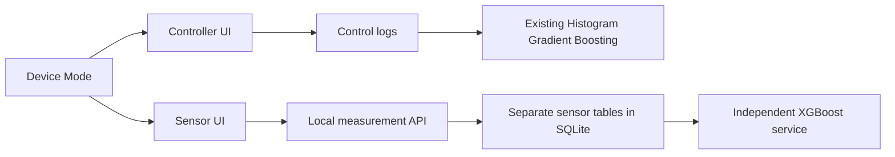

# Controller and sensor workspaces

The controller repository is the implementation target. The sibling Sensor
project supplied the read-only page-format and XGBoost reference; its source,
environment and database were not edited.

## Accepted implementation brief

1. **Understanding:** add Controller / Monitoring / Both, a preparation modal and
   sensor pages using the controller's shell and supplied sensor arrangement.
2. **Evidence:** `sidebar-loader.js` supplies navigation; the Sensor project has
   Analytics/Telemetry/Scheduler/Logs; the registry permits null controller/protocol.
3. **Enhanced prompt:** persist mode locally, filter navigation/routes, replace the
   custom three-page UI, leave Rules Management behavior, reuse the controller
   forecast template for sensor logs, and keep controller/sensor models separate.
4. **Scope:** shell/profile Device Mode, sensor UI, local API extensions, authenticated
   controller-free AC registration, independent XGBoost cache and focused tests.
5. **Validation:** isolated real Flask/SQLite, browser/Electron UI, API/security
   fixtures, model coexistence and controller regressions.
6. **Constraints:** preserve staged user work, records and auth/RLS; no dependency
   changes, environment replacement or firmware changes; cloud writes limited to
   the approved shared device-role migration and subsequently requested existing-device sensor configuration.
7. **Questions resolved:** full sensor navigation; existing Rules page retained;
   original XGBoost kept with unavailable forecasts for missing inputs (option 2).
8. **Decision:** READY_TO_IMPLEMENT under the explicit build requests.

## Navigation and persistence

| Workspace | Pages |
| --- | --- |
| Controller | Dashboard, AC Control, Control Energy Forecast, Protocol Studio |
| Monitoring | Analytics, Telemetry, Sensor Energy Forecast |
| Shared | Register AC Devices, AC Device Scheduler, existing Rules, Notifications, Maintenance, Admin Profile (Device Mode) |

Both shows both groups. Sensor Monitoring appears first. Register AC Devices has one link under System & Logs in Monitoring mode and under Devices & IR otherwise. AC Device Scheduler has one shared entry under System & Logs. `app-mode.js` executes before other page dependencies,
uses `ecoTrack_workspace_mode`, filters links and redirects incompatible pages.
The default is Both. The standalone Settings page and its navigation link were removed; the selector is a fourth Admin Profile tab with three cards and minimal text. Every selection shows preparation, saves locally and updates
the shell; other windows synchronize. Failed storage keeps the previous setting.
Login opens the selected home. This preference changes the workspace; it is not
an authorization boundary and does not change physical operation or erase records.
The Open workspace button and its footer divider were removed as requested;
the save status and mode preparation behavior remain.

Sensor Energy Forecast retains `sensor-logs.html` as its route. Its title and
navigation use the new name. Period, tariff and PDF/Excel actions occupy the
controller-style compact header, with sensor/date filters in the second row.
Top Consumers uses the controller layout and leaves rankings unavailable without valid kWh. The date selector/custom date and time range use UTC+08:00. PDF exports controller-format sensor analysis and estimate coverage; Excel exports all filtered raw rows, including an honest empty report; CSV was removed from the UI. All 12 table headings stay visible with no records.

## Data and model separation

The additive `sensor_schedules` table saves requested reporting configuration;
the sensor must apply it through firmware. Historical sensor name, location, AC
type and optional voltage/RSSI/status are preserved when received. Missing old
values stay null. Confirmed power/runtime retains the existing evidence/cadence
rules. Pairing uses the existing admin IPC guard and hashed device credentials.
The renderer sees the pairing credential once, masked, and never the admin token.

Controller-free AC registration inserts a new registry row with explicit null
controller/protocol/capacity/install date. It does not overwrite an assignment or
create a power state. The signed-in client's existing grants/RLS are used. The
[Supabase insert API](https://supabase.com/docs/reference/javascript/insert) and
live schema metadata were initially checked read-only. The shared device-role
migration below was subsequently applied after explicit approval.

## Original sensor XGBoost

`backend/ml/sensor_xgboost/` preserves the source model and its SHA-256 manifest.
Its features are `status_mode`, `pressure_high`, `pressure_low`, `pressure_diff`,
`ambient_temp`, `hour`, `day_of_week`, `energy_lag_1`, `pressure_high_roll3`, and
`ambient_temp_roll3`. These are not verified mappings for outlet temperature,
one differential pressure sensor and confirmed AC state. The training target
unit/time interval is undocumented. The source code's fixed substitutes and
output multiplication/absolute value were not transferred.

Per the user's option 2, the original model loads locally and is kept independent
of the controller model; the legacy artifact remains unavailable for absent inputs
and unverified training metadata. The subsequently selected NREL estimator is the active sensor estimate service. A fully explicit artificial input vector verifies
runtime inference only, never physical accuracy or a kWh conversion. Training-version
warnings were captured. No library was downgraded and no synthetic training set used.

## Running

Restart Flask and Electron after the route/preload changes using the existing
startup commands. Open Admin Profile → Device Mode to choose a workspace. Device registration stays on
Register AC Devices. The duplicate Register AC Sensor entry in Telemetry was removed; authenticated sensor provisioning APIs remain compatible.
Registry setup requires existing online admin verification. Paired-device ingestion,
readings, local analytics and mode changes work without internet on the local LAN.
Firmware, physical calibration and hardware schedule delivery remain excluded.

## Scheduler and sensor page updates

The old sensor scheduler URL redirects to `scheduler.html`. Both and Monitoring
use the controller cabinet/table template with registered AC names, connectivity
states, wake/sleep, Minutes/Hours intervals and Apply. Only Controller exposes
climate settings and seconds. Fractional minutes preserve real saved cadence;
configuration is never silently rounded to a longer interval. Both merges a
controller/sensor pair by exact AC database ID, while delivery evidence stays
separate. A requested wake window does not prove the device is sleeping.

Telemetry has the reference desktop two-panel layout, with a scheduler-style
Location cabinet and metric cards. Cached/authenticated room metadata can be
shown without measurements. No sensor count or reading is fabricated. The
Available AC Sensors panel, dropdown and duplicate registration button are gone.
The reference projects are not edited. Panels fill available desktop height and
stack on narrow screens. Details dialogs are read-only and keyboard accessible.

Analytics uses the forecast-style two-row header. Its history chart includes
Cool/Fan Only from optional reported `operating_mode` and ON/OFF from confirmed
`ac_on`. Mixed/missing buckets stay gaps. The empty temperature scale is 0–40 °C;
real negative or high temperatures expand the measured scale. Routine backup and
healthy-backend text is removed from visual flows; API errors remain visible.
The device table hides IR Monitoring in Monitoring and Both modes. Refresh is an accessible icon.

## Final screenshot corrections and device-role registration

- Scheduler has separate Aircon Name and AC Device Name columns, Minutes/Hours
  in all modes (Seconds only Controller), a compact unit menu, no default
  delivery/equal-time notes, and mode-specific empty wording/action.
- Notification/Scheduler/Telemetry cabinets share nested building/floor/room
  styling and selected room cards. Telemetry removes All locations and selects
  an available room. Legacy combined display locations parse into real levels.
- Sensor pages/manual refreshes and scheduler loads use skeletons.
- Controller/Both remove Remote Layout, handset imagery, Desktop Standard
  switcher, previous/next selector arrows and quick power pill.
- Sensor forecast empty logs retain the centered icon/title/description but
  remove Jump to Today and Clear Filters. Tariff/Top Consumers use actual
  controller dialog markup. PDF/Excel follow the controller report design while
  exporting only selected sensor records and honest missing estimates.
- Maintenance says AC Sensor Device in Monitoring, AC Device in Both, and
  AC Controller in Controller; records and selections follow actual device roles.
- Registration Details requires Monitoring Only / Control Only / Both Controlling
  and Monitoring. Monitoring roles request actual pressure sensor metadata;
  Monitoring Only omits IR and never claims the AC control assignment. The
  named mobile Control repository has the same picker/registration behavior.
- Register AC Devices filters rows/totals by saved role. Missing legacy roles are
  Controller. Monitoring includes Monitoring/Both, Controller includes
  Controller/Both, Both includes all. Hide IR Monitoring in Monitoring/Both.
- Registration badges show each step number once; Cancel has a visible outline.
- Shared cloud migration 20261019230000_ac_device_roles.sql is identical in both
  repositories and was applied after explicit user approval. Shared Supabase
  migration history records version 20261019162831 / ac_device_roles. Fields,
  constraints, trigger and RPC authorization were verified; existing node/AC
  identities and assignments were preserved. No firmware/physical success is
  claimed. See REPORT.md for current verification evidence.

## Active experimental sensor estimator and export presentation

The user subsequently chose experimental temperature-based estimates after comparing Random Forest, HistGradientBoosting and XGBoost on the real NREL BENEFIT laboratory data. XGBoost won validation MAE. See reports/sensor-nrel-model/REPORT.md for exact splits, untouched tests and field limitations. This active estimator is independent of the preserved legacy sensor pickle and controller HGB.

Six actual outlet temperatures over five minutes estimate current electrical power. Actual timestamps integrate covered intervals only; missing/invalid histories remain unavailable. No pressure/state substitutes, capacity scaling, runtime backfill or future forecast are generated. The full-width experimental/field-unverified banner is removed at the user's request; compact estimate labels remain. Empty chart axes are hidden, with a centered concise reason. Energy/cost/rankings and reports use the same selected estimate response.

Sensor exports use the controller-style cloud icon, progress, Cancel modal. Progress reflects completed preparation stages and reaches 100 only after the file is built. Cancel/Escape abort pending requests and prevent downloading; errors restore both export buttons. PDF excludes raw telemetry; Excel retains the 12-column raw log sheet. The controller's progress fill has an explicit visible gradient.

Telemetry counts each sensor device/card once. Cards omit the AC Device label and hardware model names; Details retains the stored role and sensor configuration. Two cards fit per desktop row, with vertical scrolling for additional devices and one-column stacking on narrow containers. Real readings remain unavailable until received. The user explicitly authorized configuring the existing cloud device for Both with those sensors; the root REPORT.md documents the preserved assignment and metadata-only change.

Telemetry previews the saved scheduler wake/sleep/interval. Shared Both devices merge by the exact monitoring UUID and use the same registered schedule displayed by the shared scheduler; separately saved monitoring-only schedules retain precedence. No schedule defaults or hardware acknowledgments are invented.

Device type in Telemetry Details uses the readable label Monitoring and Controlling for stored role both, including a paired device matched by monitoring UUID. The stored role is unchanged.

PDF/Excel formatting was compared directly with the controller's runtime exporters. The monitoring PDF uses the same landscape cover, typography, palette, section/table style and page furniture, with sensor directory/ranking, energy/cost profiles, first/final readings, aggregation, measured temperature/pressure trends and a monitoring executive summary. Excel follows the same summary, device estimates, directory and interval structure, with formulas linked to its tariff cell. All data comes from the selected monitoring snapshot and monitoring estimator, including in Both mode. Controller commands, target settings, installation verification and control-rule data are not imported. The old five-paragraph notes block is removed; the full raw table remains Excel only. See reports/workspace-modes/report-format/FORMAT_COMPARISON.md for the mapping and validation.

The Telemetry AC Power badge says Not reported when confirmed ON/OFF feedback is missing, and No recent feedback when a known reading is stale. Fresh explicit feedback still displays Confirmed ON/OFF. This wording does not change or infer physical power state.
